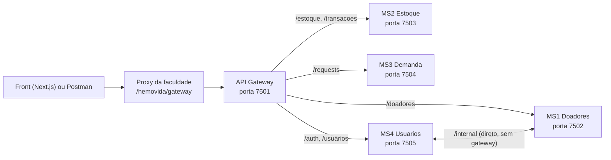

# HemoVida API Gateway

Ponto de entrada único das APIs do **HemoVida** (projeto integrador Senac RJ). O front chama só o gateway, e o gateway encaminha cada pedido para o microsserviço certo, sem alterar status, corpo nem o token de login.

## Sobre o projeto HemoVida

O **HemoVida** é um sistema para apoiar o dia a dia de um hemocentro (banco de sangue), conectando três públicos:

- **Doadores:** se cadastram, consultam e atualizam seus dados e acompanham o histórico de doações.
- **Equipe do hemocentro** (recepção, enfermagem, laboratório e gestão de estoque): atende o doador no dia, faz a triagem e a coleta, lança resultados de exames e controla as bolsas de sangue em estoque.
- **Hospitais:** solicitam bolsas de sangue e acompanham o andamento dos pedidos.

O sistema foi feito como projeto integrador do Senac RJ e é dividido em quatro microsserviços (doadores, estoque, demanda e usuários) mais o front-end. **Este repositório é o API Gateway**, a porta de entrada que liga o front a todos eles.

## Sumário

1. [O que é e por que existe](#1-o-que-é-e-por-que-existe)
2. [Arquitetura](#2-arquitetura)
3. [Tecnologias](#3-tecnologias)
4. [Como o gateway funciona](#4-como-o-gateway-funciona)
5. [Tabela de rotas](#5-tabela-de-rotas)
6. [Regras de segurança](#6-regras-de-segurança)
7. [Respostas de erro do gateway](#7-respostas-de-erro-do-gateway)
8. [Variáveis de ambiente](#8-variáveis-de-ambiente)
9. [Como rodar localmente](#9-como-rodar-localmente)
10. [Docker e Docker Compose](#10-docker-e-docker-compose)
11. [Deploy no servidor da faculdade](#11-deploy-no-servidor-da-faculdade)
12. [Como testar](#12-como-testar)
13. [Estrutura do projeto](#13-estrutura-do-projeto)
14. [Decisões de projeto e limitações](#14-decisões-de-projeto-e-limitações)
15. [Solução de problemas](#15-solução-de-problemas)

---

## 1. O que é e por que existe

O HemoVida é dividido em **microsserviços**: cada parte do sistema (doadores, estoque, demanda, usuários) é uma API separada, com banco de dados próprio. Sem um gateway, o front precisaria conhecer o endereço e a porta de cada uma.

O **API Gateway** resolve isso:

- **Um endereço só para o front.** O front chama o gateway e não precisa saber onde cada serviço mora.
- **Roteamento por prefixo.** `/doadores` vai para o MS1, `/estoque` para o MS2, e assim por diante.
- **Proteção das rotas internas.** Caminhos `/internal` (conversa entre serviços) nunca saem pelo gateway.
- **Proteção do cadastro público.** Limite de cadastros por IP na rota aberta `POST /doadores`.
- **Tratamento de falhas.** Se um serviço cai, o front recebe uma resposta clara (502), e não um erro solto.

## 2. Arquitetura



| Serviço | Porta | Função |
|---|---|---|
| Front-end | 7500 | Interface (Next.js) |
| **API Gateway** | **7501** | **Este repositório** |
| MS1 Doadores | 7502 | Cadastro e dados dos doadores |
| MS2 Estoque | 7503 | Estoque de sangue e transações |
| MS3 Demanda | 7504 | Solicitações de demanda dos hospitais |
| MS4 Usuários | 7505 | Login e gestão de usuários |

**Endereço público do gateway:** `http://academico3.rj.senac.br/hemovida/gateway`

O proxy da faculdade remove o prefixo `/hemovida/gateway` antes de entregar o pedido ao gateway. Por isso o gateway "enxerga" apenas `/health`, `/auth/...`, `/doadores` e as demais rotas, sem o prefixo.

## 3. Tecnologias

| Tecnologia | Para quê |
|---|---|
| Node.js 24 | Ambiente de execução |
| NestJS 12 (Express 5) | Framework da aplicação |
| TypeScript | Linguagem |
| `@nestjs/axios` (HttpService) | Cliente HTTP que encaminha os pedidos |
| `@nestjs/config` | Leitura das variáveis de ambiente |
| `express-rate-limit` | Limite de cadastros na rota pública |
| Docker e Docker Compose | Empacotamento e execução |
| Jenkins + Infisical | Deploy e gestão de segredos |

## 4. Como o gateway funciona

### 4.1 Caminho de um pedido

1. O pedido chega no gateway (por exemplo, `GET /doadores?page=1&limit=10`).
2. O gateway compara o começo do caminho com a **tabela de rotas** (`src/config/rotas.ts`).
3. Ao achar o prefixo (`/doadores`), ele descobre o destino (MS1) lendo a variável de ambiente correspondente (`MS1_URL`).
4. Ele encaminha o pedido para o destino, mantendo o caminho completo, a query string, o método e o corpo.
5. A resposta do serviço volta para o cliente **do jeito que veio**: mesmo status, mesmo corpo.

### 4.2 Proxy transparente

O gateway não interpreta nem altera o que passa por ele:

- **Status HTTP:** todos os status passam sem mudança (200, 400, 401, 403, 404, 500...). Um 401 do MS1 chega como 401 no front.
- **Corpo:** enviado em streaming, sem ler nem reescrever.
- **Redirecionamentos:** não são seguidos pelo gateway (`maxRedirects: 0`).
- **Cabeçalhos enviados ao serviço:** apenas `authorization`, `content-type`, `content-length` e `accept`. Qualquer outro cabeçalho enviado pelo cliente é descartado.
- **Cabeçalho `x-forwarded-for`:** o gateway acrescenta o IP que ele viu na conexão, para o MS4 limitar tentativas de login por pessoa.
- **Cabeçalhos da resposta:** só o `content-type` é copiado de volta.

### 4.3 Quem valida o token?

**Cada serviço valida o token sozinho.** O gateway apenas repassa o `Authorization: Bearer <token>` sem alterar. Isso é uma decisão de segurança: se um serviço confiasse só no gateway, bastaria alguém acessá-lo diretamente para entrar sem login.

O login é feito pelo MS4 (`POST /auth/login/admin` e `POST /auth/login/doador`), que gera o token. O MS1, MS2 e MS3 conferem esse token com o mesmo `JWT_SECRET`.

## 5. Tabela de rotas

Definida em `src/config/rotas.ts`:

| Prefixo | Destino | Variável | O que atende |
|---|---|---|---|
| `/auth` | MS4 Usuários | `MS4_URL` | Login de admin e de doador |
| `/usuarios` | MS4 Usuários | `MS4_URL` | Gestão de usuários (somente ADMIN) |
| `/doadores` | MS1 Doadores | `MS1_URL` | Cadastro e consulta de doadores |
| `/estoque` | MS2 Estoque | `MS2_URL` | Estoque de sangue |
| `/transacoes` | MS2 Estoque | `MS2_URL` | Transações de estoque |
| `/requests` | MS3 Demanda | `MS3_URL` | Solicitações de demanda |
| `/health` | O próprio gateway | nenhuma | Verificação de saúde |

### Rotas que o gateway expõe, por serviço

**MS1 Doadores**

| Método | Rota | Quem acessa |
|---|---|---|
| POST | `/doadores` | Pública (cadastro, com limite por IP) |
| GET | `/doadores?page=&limit=` | ADMIN, RECEPCAO, ENFERMAGEM |
| GET | `/doadores/cpf/:cpf` | ADMIN, RECEPCAO, ENFERMAGEM |
| GET | `/doadores/me` | DOADOR |
| GET | `/doadores/:id` | Equipe, ou o próprio DOADOR |
| PUT | `/doadores/:id` | ADMIN, RECEPCAO, ou o próprio DOADOR |
| DELETE | `/doadores/:id` | ADMIN, RECEPCAO (desativa, não apaga) |

**MS4 Usuários**

| Método | Rota | Quem acessa |
|---|---|---|
| POST | `/auth/login/admin` | Pública |
| POST | `/auth/login/doador` | Pública |
| POST | `/usuarios` | ADMIN |
| GET | `/usuarios?page=&limit=&perfil=&ativo=` | ADMIN |
| GET, PUT, DELETE | `/usuarios/:id` | ADMIN (DELETE desativa) |

**MS3 Demanda** (todas exigem perfil GESTOR_DEMANDA)

| Método | Rota |
|---|---|
| POST | `/requests` |
| GET | `/requests` |
| GET | `/requests/:id` |
| PATCH | `/requests/:id/cancel` |

**MS2 Estoque:** rotas sob `/estoque` e `/transacoes`, conforme a documentação do MS2.

> As permissões (quem acessa) são aplicadas **pelos próprios serviços**. O gateway só encaminha.

## 6. Regras de segurança

| Regra | O que faz |
|---|---|
| **Bloqueio de `/internal`** | Qualquer caminho que comece com `/internal` responde 404 no gateway. Essas rotas existem só para MS1 e MS4 conversarem entre si, protegidas por `SERVICE_KEY`. Essa conversa vai direto de serviço para serviço, nunca pelo gateway. |
| **Token sem alteração** | O `Authorization` é repassado como veio. Cada serviço continua validando o token. |
| **Lista de cabeçalhos** | Só 4 cabeçalhos do cliente chegam aos serviços. Isso impede que alguém envie cabeçalhos próprios para se passar por outra pessoa. |
| **IP real do cliente** | O gateway acrescenta o IP da conexão ao `X-Forwarded-For`. O MS4 usa esse IP para limitar tentativas de login por pessoa (e não pelo IP do gateway). |
| **Limite de cadastros** | `POST /doadores` é público. Para evitar cadastros em massa, cada IP pode fazer **20 pedidos a cada 15 minutos**. Passou disso, recebe 429. As demais rotas não têm esse limite. |
| **Segredos fora do código** | Nada de senha ou chave no repositório. As configurações vêm de variáveis de ambiente (ver seção 8). |

## 7. Respostas de erro do gateway

Erros gerados pelo próprio gateway (os erros dos serviços passam sem mudança):

| Situação | Status | Corpo |
|---|---|---|
| Serviço de destino fora do ar ou inacessível | 502 | `{"erro":"Serviço de destino indisponível."}` |
| Caminho `/internal/...` | 404 | `{"erro":"Rota não encontrada."}` |
| Limite de cadastros estourado | 429 | `{"erro":"Muitas tentativas de cadastro. Tente novamente mais tarde."}` |
| Rota que não existe na tabela | 404 | JSON padrão do Nest (`Cannot GET ...`) |

## 8. Variáveis de ambiente

O gateway **se recusa a iniciar** se faltar o endereço de algum serviço da tabela de rotas (a mensagem de erro diz qual variável falta).

| Variável | Obrigatória | Padrão | Descrição |
|---|---|---|---|
| `PORT` | Não | `7501` | Porta em que o gateway escuta |
| `MS1_URL` | Sim | | Endereço do MS1 Doadores |
| `MS2_URL` | Sim | | Endereço do MS2 Estoque |
| `MS3_URL` | Sim | | Endereço do MS3 Demanda |
| `MS4_URL` | Sim | | Endereço do MS4 Usuários |
| `TRUST_PROXY` | Não | `1` | Quantos proxies existem na frente do gateway. Define de onde o gateway lê o IP do cliente para o limite de cadastros. Precisa ser um número. |

Arquivo `.env.example` (copie para `.env` e ajuste):

```env
PORT=7501
MS1_URL=http://localhost:7502
MS2_URL=http://localhost:7503
MS3_URL=http://localhost:7504
MS4_URL=http://localhost:7505
# Opcional: número de proxies na frente do gateway (padrão 1)
# TRUST_PROXY=1
```

> O arquivo `.env` **nunca** vai para o Git (está no `.gitignore`). Só o `.env.example` é versionado.

No servidor, os valores reais ficam no **Infisical** (projeto do gateway) e são exportados para um `.env` durante o deploy.

## 9. Como rodar localmente

### Pré-requisitos

- Node.js 24 e npm
- Git
- (Opcional) os microsserviços rodando localmente, para testar o encaminhamento de verdade

### Passo a passo

```bash
# 1. Baixar o projeto
git clone https://github.com/biafraga/Gateway_20262M_prj5_hemovida.git
cd Gateway_20262M_prj5_hemovida

# 2. Instalar as dependências
npm install

# 3. Criar o arquivo de configuração (Windows)
copy .env.example .env
# Em Linux ou Mac: cp .env.example .env

# 4. Rodar em modo desenvolvimento (reinicia ao salvar arquivos)
npm run start:dev
```

Quando aparecer `Gateway no ar em http://localhost:7501`, está pronto. Confira no navegador: <http://localhost:7501/health>.

### Scripts

| Comando | O que faz |
|---|---|
| `npm run start:dev` | Roda com reinício automático (desenvolvimento) |
| `npm run build` | Compila o TypeScript para a pasta `dist` |
| `npm run start:prod` | Roda a versão compilada (produção) |

### Rodando junto com os microsserviços

Cada serviço roda no seu próprio terminal, na sua porta (7502 a 7505). Sem eles ligados, o gateway funciona, mas responde 502 para as rotas daquele serviço.

## 10. Docker e Docker Compose

O projeto tem `Dockerfile`, `.dockerignore` e `docker-compose.yml`.

- **Dockerfile:** usa a imagem `node:24-bookworm-slim`, instala as dependências com `npm ci`, compila com `npm run build` e inicia com `npm run start:prod` na porta 7501.
- **docker-compose.yml:** sobe o serviço `hemovida-gateway`, mapeia a porta `7501:7501` e lê as variáveis do arquivo `.env`.

```bash
# Com o arquivo .env já criado
docker compose up -d --build

# Ver os logs
docker compose logs -f

# Parar
docker compose down
```

Dentro do container, os endereços `MS1_URL` a `MS4_URL` **não podem ser `localhost`** (localhost, dentro do container, é o próprio container). Use o endereço do servidor onde os serviços rodam.

## 11. Deploy no servidor da faculdade

O deploy é automático, feito pelo **Jenkins** a partir do `Jenkinsfile` do repositório:

1. O Jenkins baixa o código do GitHub.
2. Exporta os segredos do **Infisical** (projeto do gateway) para um arquivo `.env`.
3. Sobe o container com `docker compose`.

Para o gateway ir ao ar com uma versão nova, basta fazer o push no GitHub e esperar o Jenkins rodar o pipeline.

Endereços no servidor:

| O quê | Endereço |
|---|---|
| Gateway (público) | `http://academico3.rj.senac.br/hemovida/gateway` |
| Front (público) | `http://academico3.rj.senac.br/hemovida` |

O proxy da faculdade precisa de uma regra para `/hemovida/gateway` que **venha antes** da regra do `/hemovida` (front) e que **remova o prefixo** `/hemovida/gateway` antes de entregar o pedido ao gateway.

## 12. Como testar

Os exemplos usam `localhost`. No servidor, troque pelo endereço público do gateway.

### 12.1 Saúde do gateway (HealthCheck)

```bash
curl http://localhost:7501/health
```

Resposta esperada (200):

```json
{ "status": "ok", "servico": "gateway", "timestamp": "2026-11-27T19:00:00.000Z" }
```

### 12.2 Login pelo gateway

No Postman: `POST http://localhost:7501/auth/login/admin`, corpo em JSON:

```json
{ "email": "admin@exemplo.com", "senha": "sua-senha" }
```

Resposta esperada (200): um JSON com `access_token`, `token_type`, `expires_in` e `role`. (O MS4 precisa estar rodando.)

### 12.3 Rota protegida

`GET http://localhost:7501/doadores` com o cabeçalho `Authorization: Bearer <access_token>` (no Postman: aba Authorization, tipo Bearer Token).

| Resultado | Significado |
|---|---|
| 200 com a lista | Tudo funcionando de ponta a ponta |
| 401 | Token ausente, inválido ou expirado (ou `JWT_SECRET` diferente entre MS1 e MS4) |
| 502 | O MS1 não está rodando |

### 12.4 Bloqueio de `/internal`

```bash
curl -i http://localhost:7501/internal/doadores/validar-login
```

Esperado: **404** com `{"erro":"Rota não encontrada."}`.

### 12.5 Limite de cadastros

No PowerShell (Windows), envia 22 pedidos seguidos para a rota pública:

```powershell
for ($i=1; $i -le 22; $i++) { curl.exe -s -o NUL -w "$i -> %{http_code}`n" -X POST http://localhost:7501/doadores -H "Content-Type: application/json" -d "{}" }
```

Esperado: as 20 primeiras retornam o status do MS1 (por exemplo 400, pois o corpo está vazio, ou 502 se o MS1 estiver desligado) e as de número 21 e 22 retornam **429**.

## 13. Estrutura do projeto

```text
.
├── src/
│   ├── main.ts                 # Inicialização: bloqueio de /internal, limite de cadastros e rotas
│   ├── app.module.ts           # Módulo principal
│   ├── config/
│   │   └── rotas.ts            # Tabela de rotas (prefixo -> serviço)
│   ├── health/
│   │   └── health.controller.ts  # GET /health
│   └── proxy/
│       ├── proxy.module.ts
│       └── proxy.service.ts    # Encaminhamento dos pedidos
├── Dockerfile
├── docker-compose.yml
├── Jenkinsfile
├── .env.example                # Modelo de configuração (sem segredos)
└── README.md
```

### Como adicionar uma rota nova

Basta uma linha em `src/config/rotas.ts` e a variável de endereço correspondente:

```ts
{ prefixo: '/nova-rota', destinoEnv: 'MS2_URL' },
```

Não é preciso mexer em mais nada.

## 14. Decisões de projeto e limitações

**Decisões**

- **Gateway "burro" de propósito.** Ele só roteia. Validação de token, perfis e regras de negócio ficam em cada serviço, para que nenhum serviço dependa do gateway para ser seguro.
- **Tabela de rotas por prefixo.** Fácil de ler e de ampliar.
- **Falha rápida na configuração.** Se faltar um endereço de serviço, o gateway nem sobe, em vez de falhar só quando alguém acessar aquela rota.
- **Serviços falam entre si direto.** A comunicação interna (MS1 e MS4) não passa pelo gateway, e as rotas `/internal` ficam bloqueadas nele.

**Limitações conhecidas**

- O limite de cadastros fica **na memória** do gateway: reinicia junto com ele e não é compartilhado entre várias instâncias (hoje existe uma só).
- O gateway **não configura CORS**. Em produção front e gateway estão no mesmo domínio, então não precisa. Rodando o front localmente (`localhost:3000`) contra o gateway, pode ser necessário habilitar CORS.
- O `/health` de cada microsserviço **não** é exposto pelo gateway; só o do próprio gateway.
- Ainda não há testes automatizados; os testes são manuais (seção 12).

## 15. Solução de problemas

| Sintoma | Causa provável | O que fazer |
|---|---|---|
| O gateway não inicia e reclama de uma variável | Falta `MS1_URL`, `MS2_URL`, `MS3_URL` ou `MS4_URL` no `.env` | Conferir o `.env` com o `.env.example` |
| 502 "Serviço de destino indisponível" | O serviço de destino está desligado ou o endereço está errado | Ligar o serviço e conferir a variável `MSx_URL` |
| 401 em rota protegida | Token expirado (dura 1 hora) ou `JWT_SECRET` diferente entre os serviços | Fazer login de novo e conferir se o `JWT_SECRET` é igual no MS1 e no MS4 (sem aspas e sem espaços) |
| 429 ao cadastrar | Limite de 20 cadastros por 15 minutos para o mesmo IP | Esperar a janela terminar |
| No servidor, o endereço do gateway abre a página 404 do front | A regra do proxy do `/hemovida` (front) está antes da regra do `/hemovida/gateway` | Colocar a regra do gateway antes da do front |
| `curl` retorna `000` | O gateway não está rodando | Subir com `npm run start:dev` |


Projeto integrador V, Senac RJ, 2026.
